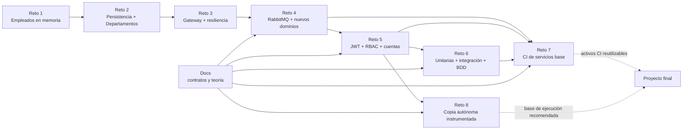
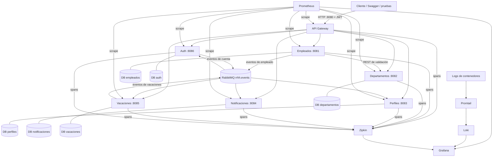

# Mapa de arquitectura y navegación del repositorio

Este documento responde tres preguntas operativas: **dónde está cada cosa**, **qué reto
depende de cuál** y **qué piezas conviene reutilizar para el proyecto final**.

## Vista rápida



El repositorio conserva cada reto como una fotografía independiente. No existe una sola
carpeta de código compartida por todos:

- `Reto_1` a `Reto_4` evolucionan el dominio y la comunicación.
- `Reto_5` reutiliza servicios de `Reto_4` y agrega seguridad.
- `Reto_6` orquesta código de `Reto_4` y `Reto_5` para probarlo.
- `Reto_7` apunta sus pipelines al código de `Reto_4`, `Reto_5` y las pruebas de `Reto_6`.
- `Reto_8` copia los siete microservicios a `Reto_8/services` y los instrumenta sin
  modificar los retos anteriores.

## Qué usar para el proyecto final

La base de ejecución más completa y autocontenida es **`Reto_8`**: reúne los siete
servicios, seis PostgreSQL, RabbitMQ, métricas, logs, trazas, dashboards y alertas. Para
completarla se reutilizan:

- contratos de negocio y eventos de `Docs/catalogo-de-eventos.md`;
- escenarios BDD de `Reto_6/e2e-tests`;
- Jenkinsfiles, conversores de reportes y configuración Sonar de `Reto_7`;
- decisiones y evidencia histórica de los README de cada reto.

Los pipelines actuales de `Reto_7` todavía apuntan a `Reto_4` y `Reto_5`. Si el proyecto
final adopta `Reto_8/services` como fuente canónica, hay que actualizar esos `SOURCE_DIR`
y rutas de pruebas de forma explícita; no conviene editar simultáneamente las copias de
`Reto_4`, `Reto_5` y `Reto_8`.

## Evolución por reto

| Reto | Aporte principal | Punto de entrada documental | Código o configuración clave | Cómo se ejecuta |
| --- | --- | --- | --- | --- |
| 1 | API FastAPI de empleados en memoria | [`Reto_1/README.md`](../Reto_1/README.md) | `Reto_1/app`, `Reto_1/tests`, `Dockerfile` | `docker build` + `docker run -p 8080:8080` |
| 2 | PostgreSQL por servicio, Departamentos y Compose | [`Reto_2/README.md`](../Reto_2/README.md) | `empleados`, `departamentos`, `docker-compose.yml` | `docker compose up -d --build --wait` en `Reto_2` |
| 3 | Entrada única, proxy y Circuit Breaker | [`Reto_3/README.md`](../Reto_3/README.md) | `api-gateway`, `empleados`, `departamentos` | Compose en `Reto_3`; sólo el Gateway se publica |
| 4 | RabbitMQ, eventos, perfiles, notificaciones y vacaciones | [`Reto_4/HANDOFF_RETO4.md`](../Reto_4/HANDOFF_RETO4.md) | seis servicios, `rabbitmq/setup.py`, cinco BD | Compose en `Reto_4` |
| 5 | Auth, JWT, RBAC, scheduler y eventos de cuenta | [`Reto_5/README.md`](../Reto_5/README.md) | `auth`, `api-gateway`, `notificaciones`, `vacaciones`, `shared` | Compose en `Reto_5` |
| 6 | Automatización de pruebas y 25 escenarios BDD | [`Reto_6/README.md`](../Reto_6/README.md) | `e2e-tests`, scripts `run_*.ps1`, Compose que reutiliza R4/R5 | Compose + `docker compose run --rm --build bdd-tests` |
| 7 | Ocho pipelines, Sonar, reportes y coordinación E2E | [`Reto_7/LEER_PRIMERO_IA_COMPANERO.md`](../Reto_7/LEER_PRIMERO_IA_COMPANERO.md) | `jenkins`, `ci`, `tests`, `infra`, Compose CI | Revisar primero el estado/evidencia; infraestructura y lógica tienen contratos separados |
| 8 | Observabilidad integral y copia instrumentada | [`Reto_8/README.md`](../Reto_8/README.md) | `services`, `observability`, `scripts`, Compose | `docker compose up --build -d --wait` en `Reto_8` |

## Arquitectura de ejecución más completa



## Propiedad de cada servicio

| Servicio | Puerto interno | Tecnología | Fuente usada por Retos 5-7 | Copia instrumentada de Reto 8 |
| --- | ---: | --- | --- | --- |
| API Gateway | 8080 | Python / FastAPI / HTTPX | `Reto_5/api-gateway` | `Reto_8/services/api-gateway` |
| Empleados | 8081 | Python / FastAPI | `Reto_4/empleados` | `Reto_8/services/empleados` |
| Departamentos | 8082 | Node.js / Express | `Reto_4/departamentos` | `Reto_8/services/departamentos` |
| Perfiles | 8083 | Go | `Reto_4/perfiles` | `Reto_8/services/perfiles` |
| Notificaciones | 8084 | Java / Spring Boot | `Reto_5/notificaciones` | `Reto_8/services/notificaciones` |
| Vacaciones | 8085 | .NET 8 | `Reto_5/vacaciones` | `Reto_8/services/vacaciones` |
| Auth | 8086 | Python / FastAPI | `Reto_5/auth` | `Reto_8/services/auth` |

## Flujos que conectan los dominios

### Onboarding

1. El cliente se autentica en `POST /auth/login` y usa el JWT contra el Gateway.
2. Se crea o valida el departamento.
3. Empleados valida el departamento por REST y persiste el alta.
4. Empleados publica `empleado.creado` en `rrhh.events`.
5. Perfiles crea su proyección; Vacaciones crea su réplica; Auth crea la cuenta;
   Notificaciones registra o envía la comunicación correspondiente.

### Vacaciones

1. Vacaciones programa el período y publica `vacaciones.programadas`.
2. El scheduler publica `vacaciones.iniciadas` o `vacaciones.finalizadas`.
3. Auth suspende o reactiva la cuenta y publica el evento de cuenta.
4. Notificaciones consume los eventos y registra la comunicación.

### Offboarding

1. El retiro se solicita al Gateway y Empleados conserva fecha y motivo de forma idempotente.
2. Empleados publica `empleado.retirado`.
3. Perfiles archiva; Vacaciones marca su réplica retirada; Auth desactiva la cuenta.
4. Notificaciones procesa la baja según el catálogo de eventos.

## Dónde modificar según el objetivo

| Necesidad | Ruta recomendada | Verificación mínima |
| --- | --- | --- |
| Contrato de evento | `Docs/catalogo-de-eventos.md` y productores/consumidores del servicio | pruebas de deduplicación + flujo RabbitMQ |
| Regla de empleados/departamentos | fuente canónica elegida (`Reto_4` o copia final en `Reto_8/services`) | unitarias + integración REST |
| JWT/RBAC/cuentas | `Reto_5/auth`, `Reto_5/api-gateway`, `Reto_5/shared` o copias R8 | pruebas Auth/Gateway + BDD |
| Scheduler de vacaciones | `Reto_5/vacaciones` o copia R8 | xUnit + flujo de eventos |
| Escenarios de negocio E2E | `Reto_6/e2e-tests` | Behave contra Gateway levantado |
| Pipeline o reporte CI | `Reto_7/jenkins`, `Reto_7/ci`, `Reto_7/tests` | `verify_ci_config.py` + Jenkins real |
| Métricas, logs, trazas o alertas | `Reto_8/observability` y `Reto_8/services` | targets Prometheus, Grafana, Loki y Zipkin |

## Comandos de operación

Desde la raíz, ejecuta un solo reto funcional a la vez cuando compartan el puerto 8080:

```powershell
# Sistema final instrumentado
Set-Location .\Reto_8
if (-not (Test-Path .env)) { Copy-Item .env.example .env }
docker compose config --quiet
docker compose up --build -d --wait --wait-timeout 600
docker compose ps

# Apagado conservando volúmenes
docker compose down
```

No uses `docker compose down -v` si necesitas conservar datos o evidencias.

## Cómo usar el grafo

- `graphify query "pregunta"`: obtiene un subgrafo relevante y rutas de archivo.
- `graphify path "A" "B"`: explica la ruta más corta entre dos conceptos.
- `graphify explain "X"`: muestra vecinos y relaciones de un nodo.
- [`graphify-out/graph.html`](../graphify-out/graph.html): exploración visual completa.
- [`graphify-out/GRAPH_REPORT.md`](../graphify-out/GRAPH_REPORT.md): comunidades, nodos centrales y preguntas sugeridas.

Las relaciones extraídas de imports, llamadas, rutas, enlaces y Compose son deterministas.
Las conexiones semánticas deducidas por documentación se identifican como `INFERRED` en el
JSON del grafo.

