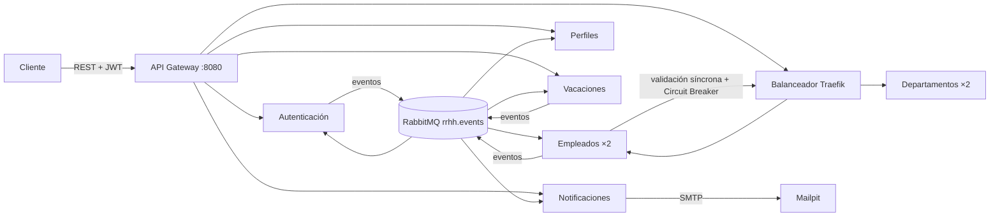

# Proyecto final · Sistema de gestión de empleados (RR. HH.)

Arquitectura orientada a microservicios que automatiza el ciclo de vida del empleado:
**onboarding**, **gestión de perfil**, **vacaciones** y **offboarding**, con observabilidad
completa, CI/CD y despliegue con un solo comando.

## 1. Descripción del proyecto

### Solución implementada

- **RR. HH. registra un empleado** → se valida su departamento, se publica `empleado.creado` y,
  de forma asíncrona, se crean la cuenta (inactiva y sin contraseña), el perfil y la notificación.
- **El empleado activa su cuenta** con un *token de activación con expiración* que recibe por
  correo. El sistema **nunca genera ni transmite contraseñas**: solo guarda su hash bcrypt.
- **Vacaciones**: un scheduler detecta el inicio y el fin de cada período; la cuenta se suspende y
  se reactiva sola, y el empleado pasa por `ACTIVO → EN_VACACIONES → ACTIVO`.
- **Retiro**: es una transición a `RETIRADO` (no un borrado) con `fechaRetiro` para auditoría;
  la cuenta se desactiva de forma permanente y el perfil se archiva.
- **No existe registro público**: las cuentas solo nacen del evento interno `empleado.creado`.

### Arquitectura general



- **Síncrono (REST)**: Cliente → Gateway → microservicio. La única llamada REST entre servicios es
  Empleados → Departamentos (validación del `departamentoId`), protegida con timeout, reintentos
  con backoff y Circuit Breaker con fallback.
- **Asíncrono (eventos)**: todo lo demás viaja por RabbitMQ con el envelope del
  [catálogo de eventos](docs/catalogo-de-eventos.md); los consumidores descartan duplicados por `id`.
- Cada microservicio es dueño de su base de datos PostgreSQL, en una red Docker interna propia.

Más detalle en [docs/arquitectura.md](docs/arquitectura.md), [docs/eventos.md](docs/eventos.md) y
las [guías](docs/guias/).

## 2. Requisitos previos

| Requisito | Versión mínima |
|---|---|
| Docker Engine / Docker Desktop | Engine 25 (Docker Desktop 4.30) |
| Docker Compose | v2.24 |
| Memoria asignada a Docker | 8 GB con CI (Jenkins + SonarQube); 5 GB sin CI |
| Bash (Linux, macOS, Git Bash) o Windows PowerShell 5.1 | para el script de secretos |

No se necesita instalar ningún lenguaje: todo se compila dentro de las imágenes.

## 3. Instrucciones de ejecución

```bash
# Clonar o descomprimir el proyecto
cd proyecto-final-microservicios

# Generar la configuración local (una sola vez)
cp .env.example .env
bash scripts/setup-secrets.sh

# Levantar todo el sistema
docker compose up --build
```

En Windows PowerShell, `.\scripts\setup-secrets.ps1` hace los dos pasos de configuración.
Para dejar la terminal libre y esperar a que todo esté sano:
`docker compose up --build -d --wait --wait-timeout 900`.

| Componente | URL |
|---|---|
| API Gateway | <http://localhost:8080> |
| Swagger UI (todos los servicios) | <http://localhost:8080/swagger> |
| Jenkins | <http://localhost:8090> |
| Grafana | <http://localhost:3000> |
| Prometheus | <http://localhost:9090> |
| Trazas (Zipkin) | <http://localhost:9411> |
| Correo (bandeja de Mailpit) | <http://localhost:8025> |
| RabbitMQ Management | <http://localhost:15672> |
| Balanceador (panel de Traefik) | <http://localhost:8088> |
| SonarQube | <http://localhost:9000> |
| Registry local | `localhost:5001` |

Todos los puertos se publican solo en `127.0.0.1` y se cambian en `.env`. El Gateway es el único
punto de entrada al negocio: los microservicios y las bases de datos no se publican.

`COMPOSE_PROFILES=ci` (valor de `.env.example`) incluye Jenkins, SonarQube y el registry en el
mismo comando. En un equipo con poca memoria puede dejarse vacío para arrancar sin CI.

Detener: `docker compose down` (agregue `-v` solo si quiere borrar también los datos).

## 4. Tecnologías utilizadas

| Microservicio | Lenguaje / framework | Base de datos |
|---|---|---|
| Gestión de Empleados | Python 3.12 · FastAPI | PostgreSQL 16 |
| Gestión de Departamentos | Node.js 22 · Express | PostgreSQL 16 |
| Autenticación y Autorización | Python 3.12 · FastAPI | PostgreSQL 16 |
| Gestión de Perfiles | Go 1.23 | PostgreSQL 16 |
| Gestión de Vacaciones | C# · .NET 8 | PostgreSQL 16 |
| Notificaciones | Java 21 · Spring Boot 3.4 | PostgreSQL 16 |
| API Gateway | Python 3.12 · FastAPI (código propio) | — |

Cinco lenguajes distintos (el mínimo exigido es cuatro).

- **Message broker**: RabbitMQ 4.1 (exchange `rrhh.events`, tipo topic).
- **Balanceador**: Traefik 3.6 con health checks activos.
- **Correo**: SMTP hacia Mailpit, con plantillas editables.
- **Observabilidad**: Loki + Promtail (logs), Prometheus + Grafana (métricas, dashboards y
  alertas a Discord), OpenTelemetry + Zipkin (trazas, W3C Trace Context).
- **CI/CD**: Jenkins (JCasC) + SonarQube + Docker Registry local.
- **Secretos**: Docker Compose Secrets.

**Sobre el stack de observabilidad**: se usa el del enunciado (Loki + Promtail + Prometheus +
Grafana + Zipkin), sin sustituciones.

## 5. Endpoints principales

Todas las rutas pasan por el Gateway (`http://localhost:8080`). Salvo las tres públicas de
`/auth`, requieren `Authorization: Bearer <token>`.

| Método | Ruta | Descripción | Quién |
|---|---|---|---|
| POST | `/auth/login` | Autenticación | público |
| POST | `/auth/reset-password` | Establecer contraseña con el token de activación o recuperación | público |
| POST | `/auth/recover-password` | Solicitar recuperación de contraseña | público |
| POST | `/auth/change-password` | Cambio de contraseña (actual + nueva) | autenticado |
| GET | `/empleados` | Listar; `?estado=RETIRADO&desde=&hasta=` para auditoría | autenticado |
| POST | `/empleados` | Crear empleado | ADMIN |
| GET | `/empleados/{id}` | Obtener un empleado | autenticado |
| GET | `/empleados/{id}/completo` | Empleado + perfil en una respuesta (composición) | autenticado |
| PUT | `/empleados/{id}` | Actualizar empleado | ADMIN |
| DELETE | `/empleados/{id}?motivo=` | Retirar (transición a `RETIRADO`, no borrado) | ADMIN |
| GET / POST | `/departamentos` | Listar / crear departamentos | autenticado / ADMIN |
| GET / PUT / DELETE | `/departamentos/{id}` | Consultar / actualizar / eliminar | autenticado / ADMIN |
| GET | `/perfiles/{empleadoId}` | Obtener perfil | autenticado |
| PUT | `/perfiles/{empleadoId}` | Actualizar perfil (**solo el propio**; otro → 403) | dueño o ADMIN |
| POST | `/vacaciones` | Programar vacaciones | ADMIN |
| GET | `/vacaciones` | Consultar vacaciones (`?empleadoId=`) | autenticado |
| GET | `/notificaciones/{empleadoId}` | Historial de notificaciones | autenticado |
| GET | `/health` | Estado del Gateway y de sus servicios | público |

La especificación OpenAPI de cada servicio está en `microservicios/<servicio>/openapi.yaml`
y, de forma interactiva, en <http://localhost:8080/swagger>.

### Ejemplos con curl (flujo completo)

```bash
BASE=http://localhost:8080

# 1) Login del administrador semilla (la contraseña está en secrets/admin_password.txt)
TOKEN=$(curl -s -X POST $BASE/auth/login -H 'Content-Type: application/json' \
  -d "{\"email\":\"admin@proyecto.local\",\"password\":\"$(cat secrets/admin_password.txt)\"}" \
  | sed 's/.*"access_token":"\([^"]*\)".*/\1/')
AUTH="Authorization: Bearer $TOKEN"

# 2) Crear un departamento y un empleado (onboarding)
curl -s -X POST $BASE/departamentos -H "$AUTH" -H 'Content-Type: application/json' \
  -d '{"id":"IT","nombre":"Tecnología","descripcion":"Departamento de TI"}'
curl -s -X POST $BASE/empleados -H "$AUTH" -H 'Content-Type: application/json' \
  -d '{"id":"E001","nombre":"Ana","apellido":"Ríos","email":"ana.rios@empresa.com",
       "numeroEmpleado":"EMP-001","cargo":"Desarrolladora","area":"Tecnología",
       "departamentoId":"IT","fechaIngreso":"2026-11-01"}'

# 3) El empleado recibe el token de activación por correo: http://localhost:8025
#    y establece él mismo su contraseña (12+ caracteres, mayúscula, minúscula y número)
curl -s -X POST $BASE/auth/reset-password -H 'Content-Type: application/json' \
  -d '{"token":"<TOKEN_DEL_CORREO>","newPassword":"<CONTRASEÑA_DEL_EMPLEADO>"}'

# 4) Empleado + perfil en una sola respuesta
curl -s $BASE/empleados/E001/completo -H "$AUTH"

# 5) Programar vacaciones (fechas en UTC, no pasadas, sin solapamiento)
curl -s -X POST $BASE/vacaciones -H "$AUTH" -H 'Content-Type: application/json' \
  -d '{"empleadoId":"E001","fechaInicio":"2026-12-15","fechaFin":"2026-12-30"}'

# 6) Retirar al empleado y consultarlo en la auditoría
curl -s -X DELETE "$BASE/empleados/E001?motivo=RENUNCIA" -H "$AUTH"
curl -s "$BASE/empleados?estado=RETIRADO&desde=2026-11-01&hasta=2026-12-31" -H "$AUTH"
```

## 6. Configuración inicial y secretos

**Ningún secreto está en el repositorio**, ni en `docker-compose.yml`, ni en `.env`.

| Archivo | Contenido | ¿Se versiona? |
|---|---|---|
| `.env.example` | Configuración no sensible (puertos, nombres, tiempos) | Sí |
| `.env` | Copia local de la anterior | No (`.gitignore`) |
| `secrets.example/` | Plantillas que documentan cada secreto | Sí |
| `secrets/*.txt` | Secretos reales, generados con valores aleatorios | No (`.gitignore`) |

- **Generación**: `scripts/setup-secrets.sh` (o `.ps1`) crea los 15 archivos de `secrets/`.
- **Uso**: `docker-compose.yml` los declara en `secrets:` y los monta en `/run/secrets/<nombre>`
  solo en los contenedores que los necesitan. Los microservicios los leen al arrancar mediante
  `docker-entrypoint.sh`; PostgreSQL y Grafana usan su soporte nativo de `*_FILE`.
- **Qué configura cada variable y cada secreto**: comentarios de [.env.example](.env.example) y
  tabla de [secrets.example/README.md](secrets.example/README.md).
- **Rotación**:

  ```bash
  bash scripts/setup-secrets.sh --force     # genera valores nuevos
  docker compose down -v                    # PostgreSQL y RabbitMQ fijan la clave al crear el volumen
  docker compose up --build
  ```

  Para rotar solo la clave JWT basta reemplazar `secrets/jwt_secret.txt` y ejecutar
  `docker compose up -d --force-recreate auth-service api-gateway` (invalida los tokens emitidos).

Detalle en [docs/guias/secretos.md](docs/guias/secretos.md).

## 7. Accesos por defecto

Este documento no contiene contraseñas: cada credencial sale de un archivo de secreto.

| Sistema | Usuario | Contraseña |
|---|---|---|
| Aplicación (administrador semilla, rol ADMIN) | `ADMIN_EMAIL` de `.env` | `secrets/admin_password.txt` |
| Grafana | `GRAFANA_ADMIN_USER` de `.env` | `secrets/grafana_admin_password.txt` |
| Jenkins | `JENKINS_ADMIN_ID` de `.env` | `secrets/jenkins_admin_password.txt` |
| SonarQube | `admin` | `secrets/sonar_admin_password.txt` |
| RabbitMQ | `RABBITMQ_USER` de `.env` | `secrets/rabbitmq_password.txt` |

- **Cómo se crea el administrador semilla**: `setup-secrets` genera una contraseña aleatoria,
  guarda su hash bcrypt en `secrets/admin_password_hash.txt` y `auth-service` crea la cuenta al
  arrancar a partir de ese hash. El servicio nunca ve la contraseña en claro.
- **Empleados**: no tienen credenciales por defecto; cada uno activa su cuenta con el token que
  recibe por correo.
- Mailpit, Zipkin, Prometheus y el panel de Traefik no piden credenciales y solo escuchan en `127.0.0.1`.

## Pruebas

| Tipo | Dónde | Cómo |
|---|---|---|
| Unitarias e integración | `microservicios/tests` (Python), `departamentos/tests` (Node), `perfiles/*_test.go`, `notificaciones/src/test`, `vacaciones.tests` | Pipelines de Jenkins (`ms-<servicio>`) |
| Funcionales BDD (25 escenarios) | `e2e-tests/` (Behave) | Job `proyecto-final` de Jenkins, o manualmente (ver [e2e-tests/README.md](e2e-tests/README.md)) |

Cobertura mínima del 70 %: la verifican las pruebas y el Quality Gate de SonarQube; por debajo
de ese valor el pipeline falla.

## Estructura

```text
├── docker-compose.yml        # Orquestación completa (un solo comando)
├── .env.example              # Configuración no sensible
├── secrets.example/          # Plantillas de los secretos
├── Jenkinsfile               # Pipeline integral
├── microservicios/           # 7 servicios: Dockerfile, Jenkinsfile, openapi.yaml y pruebas
├── e2e-tests/                # Suite BDD (Behave)
├── observabilidad/           # Prometheus, Grafana (dashboards y alertas), Promtail
├── infra/                    # Jenkins (JCasC) y aprovisionamiento de SonarQube
├── docs/                     # arquitectura.md, eventos.md, catálogo y guías
└── scripts/                  # setup-secrets, datos de prueba, exportación OpenAPI
```
