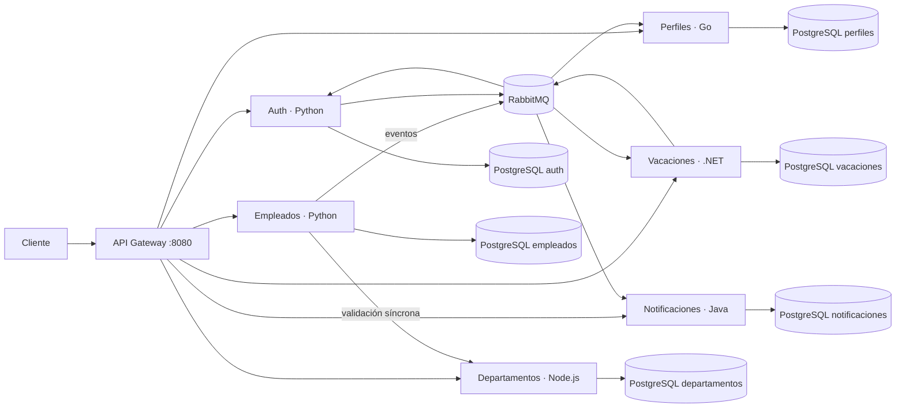

# Arquitectura del proyecto final

## Flujo principal

Cada servicio es dueño de su base de datos. La comunicación síncrona se limita a las
consultas que requieren respuesta inmediata; los cambios de ciclo de vida se propagan por
eventos versionados. El contrato normativo está en [catalogo-de-eventos.md](catalogo-de-eventos.md).

## Ciclo de vida

1. El administrador crea un empleado y Empleados valida el departamento.
2. `empleado.creado` habilita la cuenta, crea el perfil, prepara vacaciones y genera la
   notificación de bienvenida.
3. Auth emite JWT; el Gateway valida autorización y enruta cada solicitud.
4. Vacaciones publica eventos de inicio y fin para mantener el estado del empleado.
5. La baja lógica publica `empleado.retirado`; los consumidores desactivan acceso y
   procesos asociados sin borrar el historial.

Los consumidores registran los identificadores procesados para que los reintentos sean
idempotentes y no dupliquen efectos.

## Observabilidad

- Prometheus extrae métricas de los siete servicios.
- Grafana aprovisiona dashboards, datasources y alertas desde archivos versionados.
- Loki y Promtail centralizan logs JSON con `traceId`.
- OpenTelemetry propaga W3C Trace Context y exporta trazas a Zipkin.
- Todos los servicios implementan health checks usados por Docker Compose.

## Seguridad operativa

- No se publican bases de datos ni puertos internos de servicios.
- `.env` y `secrets/` son locales y están ignorados por Git.
- `scripts/setup.*` genera credenciales aleatorias y un hash bcrypt para la cuenta semilla.
- `.env.example` solo contiene marcadores, nunca valores válidos.
- Antes de compartir el repositorio debe ejecutarse un escáner de secretos sobre todo el
  historial, no solamente sobre el árbol actual.
