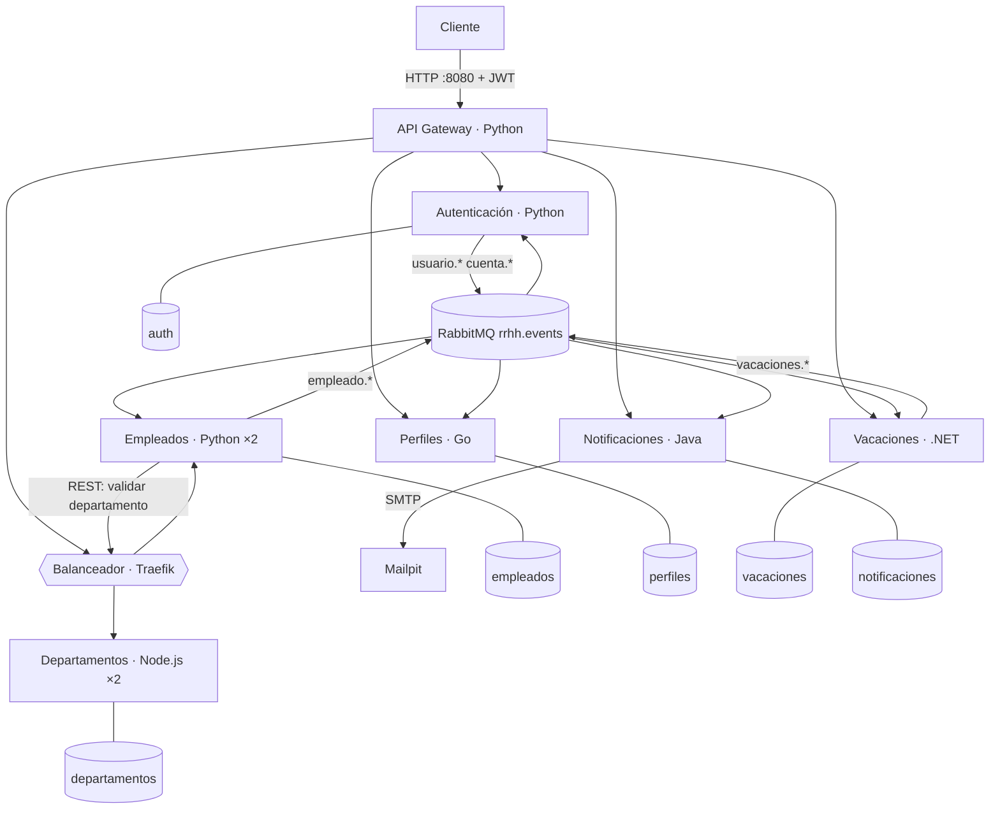

# Arquitectura del proyecto final

## Vista de componentes

| Capa | Componentes | Red Docker |
|---|---|---|
| Entrada | API Gateway (único puerto de negocio publicado) | `microservices-network` |
| Negocio | 6 microservicios + balanceador interno | `microservices-network` |
| Mensajería | RabbitMQ, Mailpit | `microservices-network` |
| Datos | 6 PostgreSQL, uno por servicio | una red **interna** por base (`*-db`): solo su servicio la alcanza |
| Observabilidad | Prometheus, Grafana, Loki, Promtail, Zipkin | `microservices-network` |
| CI/CD | Jenkins, SonarQube, registry | `ci-network` |

Volúmenes persistentes: uno por base de datos, RabbitMQ, Prometheus, Loki, Grafana, Jenkins,
SonarQube y el registry.

## Comunicación

- **Síncrona (REST)**: Cliente ↔ Gateway ↔ microservicios. Entre servicios existe una sola
  llamada: Empleados valida el `departamentoId` contra Departamentos (fuente de verdad).
  Si el departamento no existe, la operación se rechaza con `400 Bad Request`.
- **Asíncrona (eventos)**: el resto, por RabbitMQ. Ver [eventos.md](eventos.md).

## Flujos de negocio

### Onboarding

1. RR. HH. (rol ADMIN) envía `POST /empleados`.
2. Empleados valida unicidad de `email` y `numeroEmpleado`, valida el departamento y guarda.
3. Publica `empleado.creado`.
4. Autenticación crea la cuenta **inactiva y sin contraseña**, genera un token de activación con
   expiración y publica `usuario.creado`. Perfiles crea el perfil. Vacaciones guarda su réplica.
5. Notificaciones envía el correo de bienvenida con el token (nunca una contraseña).
6. El empleado llama a `POST /auth/reset-password` con el token y su contraseña; la cuenta se activa.

### Vacaciones

1. RR. HH. programa el período (`POST /vacaciones`): fechas coherentes, no pasadas, sin
   solapamiento, empleado existente. Se publica `vacaciones.programadas` (correo de confirmación).
2. El scheduler publica `vacaciones.iniciadas` en la fecha de inicio: la cuenta se suspende y el
   empleado pasa a `EN_VACACIONES`.
3. Al terminar publica `vacaciones.finalizadas`: la cuenta se reactiva y el empleado vuelve a `ACTIVO`.

### Offboarding

1. RR. HH. envía `DELETE /empleados/{id}?motivo=...`: el registro **no se borra**, pasa a
   `RETIRADO` con `fechaRetiro`.
2. `empleado.retirado` desactiva la cuenta de forma permanente, archiva el perfil y deja la
   notificación. La auditoría se consulta con `GET /empleados?estado=RETIRADO&desde=&hasta=`.

## Seguridad

- **Autenticación**: servicio propio (opción *a* del enunciado). JWT HS256 firmado por
  Autenticación y validado en el Gateway con la clave compartida `jwt_secret`.
- **RBAC por rol**: `ADMIN` (RR. HH.) puede crear, actualizar y retirar; `USER` solo consulta.
- **Autorización por propiedad del recurso**: un `USER` solo puede hacer `PUT /perfiles/{id}`
  sobre su propio `id`; sobre otro recibe `403 Forbidden`.
- **Sin registro público**: no existe `/register`; las cuentas las crea el consumidor de
  `empleado.creado`.
- **Contraseñas**: solo hash bcrypt (coste 12). Nunca viajan por correo ni por eventos; los
  tokens de activación y recuperación van únicamente dentro del correo y no se escriben en los logs.
- **Secretos**: Docker Compose Secrets (ver [guias/secretos.md](guias/secretos.md)).
- Las cabeceras `X-Authenticated-*` que envía el cliente se descartan en el Gateway, que las
  vuelve a generar a partir del token validado.

## Escalabilidad y resiliencia

- **Servicios stateless**: todo el estado está en PostgreSQL o RabbitMQ; cualquier réplica
  atiende cualquier petición.
- **Escalado horizontal**: Empleados y Departamentos corren con 2 réplicas
  (`EMPLEADOS_REPLICAS`, `DEPARTAMENTOS_REPLICAS`) detrás de Traefik.
- **Health checks del balanceador**: sondeo activo a `GET /health` cada 5 s; una instancia caída
  o `DOWN` sale de la rotación y vuelve sola al recuperarse. Si una réplica muere a mitad de una
  petición, se reintenta en otra.
- **Circuit Breaker** (Empleados → Departamentos): timeout de 2 s, 3 reintentos con backoff
  exponencial y apertura tras 3 fallos. **Fallback**: el alta se acepta con `202` y estado
  `PENDIENTE`, y una tarea de reconciliación la confirma (o la rechaza) cuando Departamentos vuelve.
- **Consumidores idempotentes**: dos réplicas compiten por la misma cola sin duplicar efectos.

Demostraciones paso a paso en [guias/escalabilidad-y-resiliencia.md](guias/escalabilidad-y-resiliencia.md).

## Observabilidad

- **Logs**: JSON estructurado (timestamp, level, service, message, traceId y contexto) →
  Promtail → Loki → Grafana.
- **Métricas**: Prometheus raspa `/metrics` de cada instancia. Además de las HTTP y de proceso
  hay métricas de negocio: `empleados_creados_total`, `empleados_retirados_total`,
  `notificaciones_enviadas_total`, `auth_logins_total`, `eventos_publicacion_errores_total`.
- **Trazas**: OpenTelemetry con W3C Trace Context entre los cinco lenguajes y a través de
  RabbitMQ, exportadas a Zipkin.
- **Alertas**: reglas de Grafana (servicio caído, tasa de 5xx, latencia) hacia Discord.
- **Health checks**: `GET /health` en todos los servicios, con el estado de base de datos y broker;
  `200` si `UP`, `503` si `DOWN`.

Guía en [guias/observabilidad.md](guias/observabilidad.md).

## CI/CD

Jenkins se configura solo (JCasC) con un pipeline por microservicio (`ms-<servicio>`) y uno
integral (`proyecto-final`). Etapas: **build → test → quality → package**; el Quality Gate de
SonarQube hace fallar el pipeline si la cobertura baja del 70 %, y las imágenes se publican en
el registry local. Guía en [guias/jenkins-y-sonarqube.md](guias/jenkins-y-sonarqube.md).
