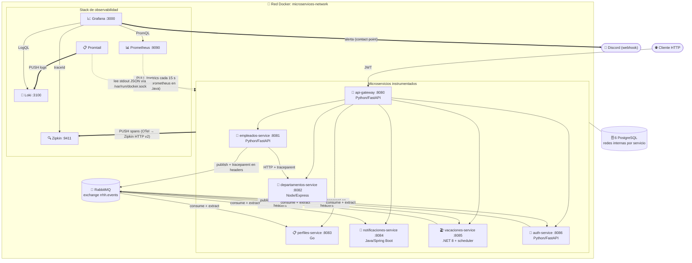
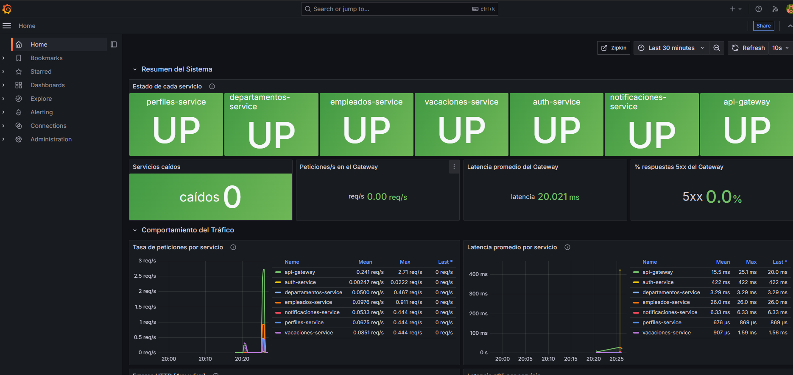
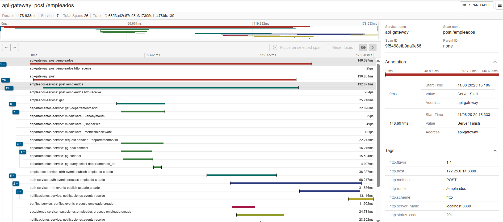

# Reto 8 – Observabilidad y Monitoreo del Ecosistema de Microservicios

Ecosistema de onboarding/offboarding de empleados (Retos 1–7) instrumentado con los **tres pilares de la observabilidad** (métricas, logs y trazas) más **alertas proactivas**.

> **Aislamiento respecto a retos anteriores.** Todo el Reto 8 vive en `Reto_8/`: los 7 microservicios se copiaron a `Reto_8/services/` y se instrumentaron ahí. `Reto_4`, `Reto_5`, `Reto_6` y `Reto_7` (pipeline de Jenkins, SonarQube y E2E) **no se modificaron**. El proyecto de Compose se llama `reto8`, así que sus contenedores y volúmenes no chocan con los del Reto 7.

| Componente | URL local | Rol |
|---|---|---|
| API Gateway | http://localhost:8080/docs | Entrada única (JWT) |
| **Grafana** | http://localhost:3000 (admin / admin) | Dashboards, logs (Loki) y alertas |
| **Prometheus** | http://localhost:9091 | Recolector de métricas (pull) |
| **Zipkin** | http://localhost:9411 | Trazas distribuidas |
| Loki | `loki:3100` (solo red interna) | Almacén de logs |
| RabbitMQ | http://localhost:15672 | Broker de eventos |

> **Puerto de Prometheus.** Dentro de Docker, Prometheus escucha en `prometheus:9090`, que es el puerto del enunciado. En el host se publica en **9091** porque Jenkins (Reto 7) ya ocupa el 9090. Así ambos retos pueden estar levantados a la vez. El puerto se cambia con `PROMETHEUS_PORT` en `.env`.

---

## 1. Diseño de la arquitectura de observabilidad

### 1.1 Diagrama (entregable previo a la implementación)



Cómo se conectan los componentes:

1. **Componentes que se levantan:** Prometheus, Grafana, Loki, Promtail y Zipkin, como servicios adicionales del `docker-compose.yml`.
2. **Prometheus → microservicios:** todo está en la red `microservices-network`. Prometheus resuelve por DNS de Docker los nombres de servicio (`api-gateway:8080`, `empleados-service:8081`, …). No usa IPs fijas.
3. **Trazas → Zipkin:** cada SDK de OpenTelemetry agrupa los spans en lotes y los envía por HTTP a `http://zipkin:9411/api/v2/spans` (modelo push). El `traceparent` (W3C) viaja en las cabeceras HTTP entre servicios y en las cabeceras AMQP de cada mensaje de RabbitMQ.
4. **Grafana:** consume Prometheus (PromQL), Loki (LogQL) y Zipkin como datasources aprovisionados por archivo. Un log con `traceId` enlaza directo a su traza.

### 1.2 Investigación

**Los tres pilares de la observabilidad**

| Pilar | Pregunta que responde | En este ecosistema |
|---|---|---|
| **Métricas** | ¿Cómo se está comportando? Son números agregados en el tiempo, baratos de guardar e ideales para dashboards y alertas. | `http_requests_total`, `http_request_duration_seconds`, CPU y memoria, `up`, en Prometheus |
| **Logs** | ¿Qué pasó exactamente en un servicio? Son eventos discretos con contexto. | JSON por línea con `timestamp`, `level`, `service`, `traceId` y `message`, en Loki |
| **Trazas** | ¿Por dónde pasó una petición y cuánto tardó cada salto? Son un árbol de spans con un `traceId` común. | OpenTelemetry → Zipkin |

Los pilares se cruzan por el `traceId`. Una alerta (métrica) lleva al dashboard; de ahí se pasa a los logs de error (Loki) y, con su `traceId`, a la cascada completa (Zipkin).

**Modelo pull vs. push**

- **Pull (Prometheus):** Prometheus inicia la conexión. Cada `scrape_interval` (15 s) hace `GET /metrics` a cada target de `prometheus.yml` y guarda las series con las etiquetas `job` e `instance`. Si el target no responde, Prometheus registra `up{job="…"} = 0`, y eso permite detectar servicios caídos sin que el servicio tenga que avisar. El servicio solo expone su estado actual.
- **Push (Zipkin):** el servicio inicia la conexión. El SDK de OpenTelemetry acumula los spans terminados en un `BatchSpanProcessor` y los envía por `POST /api/v2/spans` a Zipkin. Las trazas son eventos efímeros y de alto volumen, así que no tiene sentido que el colector los consulte. Loki también recibe por push: Promtail le envía las líneas de log.

**OpenTelemetry y la CNCF**

La **CNCF** (Cloud Native Computing Foundation, bajo la Linux Foundation) aloja proyectos *cloud native* neutrales respecto al proveedor: Kubernetes, Prometheus, Jaeger, OpenTelemetry, etc. **OpenTelemetry** nació de la fusión de OpenTracing y OpenCensus y es el estándar abierto para generar y exportar telemetría (API, SDK, convenciones semánticas y protocolo OTLP). Es relevante porque es **agnóstico**:

- Se instrumenta una vez y el destino se cambia con configuración (Zipkin, Jaeger, Tempo, Datadog…).
- Tiene SDK para todos los lenguajes del ecosistema (Python, Node, Go, Java y .NET), con el mismo modelo de spans y la misma propagación. Eso permite que una traza cruce 5 lenguajes sin perder el hilo.

**W3C Trace Context**

Es la recomendación W3C que estandariza las cabeceras de propagación:

```
traceparent: 00-0af7651916cd43dd8448eb211c80319c-b7ad6b7169203331-01
             │  └──────── trace-id (16 bytes) ────┘ └ parent span-id ┘ └ flags (01 = muestreado)
             └ versión
tracestate:  datos específicos del proveedor (opcional)
```

1. El primer servicio, el Gateway, crea el `trace-id`.
2. Cada cliente HTTP instrumentado inyecta `traceparent` con el id de su span actual.
3. El servidor que recibe la petición, sin importar su lenguaje, extrae la cabecera y crea su span como **hijo**.
4. Como todos los SDK usan el propagador `tracecontext,baggage`, un span de FastAPI puede ser padre de uno de Express o de Spring.
5. En RabbitMQ no hay propagación automática: el productor escribe `traceparent` en las cabeceras del mensaje y el consumidor lo lee (ver §4.2).

### 1.3 Zipkin vs. Jaeger: elegimos **Zipkin**

| Criterio | Zipkin | Jaeger |
|---|---|---|
| Despliegue | 1 contenedor (`openzipkin/zipkin`), almacenamiento en memoria | all-in-one también existe, pero con más puertos y opciones |
| Exportador en los 5 SDK | Nativo: `opentelemetry-exporter-zipkin-json`, `@opentelemetry/exporter-zipkin`, `otel/exporters/zipkin`, `OpenTelemetry.Exporter.Zipkin`, `opentelemetry-exporter-zipkin` (Spring) | Por OTLP (recomendado); su exportador propio está deprecado |
| Spring Boot 3 | `management.zipkin.tracing.endpoint` es configuración de primera clase | Requiere OTLP |
| Recursos | JVM liviana (limitada a 384 MB) | Similar |
| Grafana | Datasource nativo | Datasource nativo |

Para un entorno académico de 7 servicios pesó más la simplicidad: un contenedor, una URL común (`http://zipkin:9411/api/v2/spans`) y soporte directo en todos los lenguajes. Jaeger sería preferible con almacenamiento persistente o con muestreo adaptativo a gran escala.

---

## 2. Infraestructura (`docker-compose.yml`)

| Servicio | Imagen | Puerto host | Notas |
|---|---|---|---|
| prometheus | `prom/prometheus:v2.55.1` | 9091 → 9090 | Configuración en `observability/prometheus/prometheus.yml`, retención de 2 días |
| grafana | `grafana/grafana:11.4.0` | 3000 | Volumen `grafana-data` (persistencia) y aprovisionamiento en `observability/grafana/provisioning` |
| loki | `grafana/loki:3.3.2` | — | Volumen `loki-data` |
| promtail | `grafana/promtail:3.3.2` | — | Monta `/var/run/docker.sock` (solo lectura) |
| zipkin | `openzipkin/zipkin:3.4` | 9411 | Almacenamiento en memoria |

Las imágenes llevan **versión fija** en lugar de `latest` para que la demo no cambie entre ensayo y sustentación. Todo comparte la red `microservices-network`. Las bases de datos siguen en sus redes `internal`.

```
Reto_8/
├── docker-compose.yml
├── .env.example
├── observability/
│   ├── prometheus/prometheus.yml
│   ├── promtail/promtail-config.yml
│   └── grafana/provisioning/
│       ├── datasources/datasources.yml          # Prometheus, Loki, Zipkin
│       ├── dashboards/dashboards.yml + json/ecosistema-rrhh.json
│       └── alerting/alert-rules.yml + contact-points.yml
├── services/                                    # 7 microservicios instrumentados + shared/
└── scripts/generar_trafico.ps1
```

## 3. Configuración de Prometheus

`observability/prometheus/prometheus.yml` define **7 scrape jobs**, con **api-gateway en primer lugar**. Los targets son nombres de servicio de Compose:

| Job | Target | `metrics_path` | Librería |
|---|---|---|---|
| api-gateway | `api-gateway:8080` | `/metrics` | prometheus-fastapi-instrumentator |
| empleados-service | `empleados-service:8081` | `/metrics` | prometheus-fastapi-instrumentator |
| departamentos-service | `departamentos-service:8082` | `/metrics` | prom-client |
| perfiles-service | `perfiles-service:8083` | `/metrics` | prometheus/client_golang |
| notificaciones-service | `notificaciones-service:8084` | **`/actuator/prometheus`** | micrometer-registry-prometheus |
| vacaciones-service | `vacaciones-service:8085` | `/metrics` | prometheus-net |
| auth-service | `auth-service:8086` | `/metrics` | prometheus-fastapi-instrumentator |

## 4. Instrumentación de los microservicios

### 4.1 Librerías por servicio

| Servicio | Lenguaje | Métricas | Trazas (OpenTelemetry → Zipkin) | Logs JSON |
|---|---|---|---|---|
| api-gateway, empleados, auth | Python 3.12 / FastAPI | `prometheus-fastapi-instrumentator` 7.0 | `opentelemetry-sdk` 1.29, `-instrumentation-fastapi`, `-instrumentation-httpx`, `-exporter-zipkin-json` | `logging` + `JsonFormatter` propio (`services/shared/observability.py`) |
| departamentos | Node 22 / Express 5 | `prom-client` 15 | `@opentelemetry/sdk-node`, `instrumentation-http`, `-express`, `-pg`, `exporter-zipkin` | `winston` (`format.json()`) |
| perfiles | Go 1.23 | `prometheus/client_golang` 1.20 | `go.opentelemetry.io/otel` 1.34, `otelhttp`, `exporters/zipkin` | `log/slog` (`JSONHandler` de la librería estándar) |
| notificaciones | Java 21 / Spring Boot 3.4 | `micrometer-registry-prometheus` (Actuator) | `micrometer-tracing-bridge-otel` + `opentelemetry-exporter-zipkin` | `logstash-logback-encoder` 8.0 (`logback-spring.xml`) |
| vacaciones | .NET 8 | `prometheus-net.AspNetCore` 8.2 | `OpenTelemetry.Extensions.Hosting`, `.Instrumentation.AspNetCore`, `.Exporter.Zipkin` 1.9 | `Serilog.AspNetCore` + formatter JSON propio |

En Spring Boot 3 se usa el puente de Micrometer Tracing hacia el SDK de OpenTelemetry en lugar de `opentelemetry-spring-boot-starter`. Es la integración nativa de Boot 3: el SDK y el exportador siguen siendo de OpenTelemetry, y además el listener de RabbitMQ propaga el contexto automáticamente con `spring.rabbitmq.listener.simple.observation-enabled=true`.

**Configuración común** (bloque `x-otel` del compose, aplicado a los 7 servicios):

```yaml
OTEL_SERVICE_NAME: <nombre>-service          # aparece en la UI de Zipkin
OTEL_EXPORTER_ZIPKIN_ENDPOINT: http://zipkin:9411/api/v2/spans   # nombre de red Docker, no localhost
OTEL_PROPAGATORS: tracecontext,baggage       # W3C Trace Context
```

**Métricas mínimas, con los mismos nombres en Python, Node, Go y .NET:**

| Métrica | Tipo | Etiquetas |
|---|---|---|
| `http_requests_total` | counter | `method`, `handler` (ruta plantilla, p. ej. `/departamentos/:id`), `status` (200, 404, 503…) |
| `http_request_duration_seconds` | histogram (`_bucket`, `_sum`, `_count`) | `method`, `handler` |
| `process_cpu_seconds_total`, `process_resident_memory_bytes` / `process_working_set_bytes` | CPU y memoria del proceso | — |

Spring Boot usa las de Micrometer: `http_server_requests_seconds_*` con las etiquetas `uri` y `status`, más `process_cpu_usage` y `jvm_memory_used_bytes`. Las consultas del dashboard y de las alertas combinan ambos formatos con `or`.

Las sondas (`/health` y `/metrics`) se excluyen de las métricas HTTP y de las trazas en todos los servicios. Así Zipkin no se llena de spans de los *healthchecks*, que corren cada 5 s.

### 4.2 Trazabilidad distribuida

- **HTTP (automático):** los SDK instrumentan los servidores (FastAPI, Express, `net/http`, Spring MVC, ASP.NET Core) y los clientes (`httpx` en el Gateway y en empleados). El `traceparent` se inyecta y se extrae solo.
- **RabbitMQ (manual):** el broker no propaga contexto. Cada publicador abre un span `PRODUCER` e inyecta `traceparent` en las cabeceras AMQP; cada consumidor lo extrae y abre un span `CONSUMER` hijo.

| Servicio | Publica (inject) | Consume (extract) |
|---|---|---|
| empleados (Python) | `shared.observability.publish_span` en `events.py` | — |
| auth (Python) | `publish_span` (`usuario.creado`, `cuenta.desactivada`…) | `consume_span` sobre `auth.events` |
| vacaciones (.NET) | `Telemetry.Inject` en `RabbitPublisher.Publish` | `Telemetry.Extract` en `EmployeeEventsConsumer` |
| perfiles (Go) | — | `startConsumerSpan` (`amqpCarrier`) |
| notificaciones (Java) | — | Spring AMQP con `observation-enabled=true` |

**El caso difícil: el scheduler de vacaciones.** `VacationScheduler.RunOnce` (.NET) no tiene petición HTTP que origine la traza. Por cada vacación que inicia abre un **span raíz manual** `scheduler.vacaciones.iniciar`, con los atributos `vacaciones.id` y `empleado.id`. Antes limpia `Activity.Current` para garantizar que sea raíz. Dentro de ese span publica `vacaciones.iniciadas` con el `traceparent` en las cabeceras. El resultado en Zipkin es **una sola cascada**:

```
scheduler.vacaciones.iniciar                 (vacaciones-service, raíz)
└─ rrhh.events publish vacaciones.iniciadas  (vacaciones-service, PRODUCER)
   ├─ auth.events process ...                (auth-service, CONSUMER)
   │  └─ rrhh.events publish cuenta.desactivada (auth-service, PRODUCER)
   │     └─ notificaciones.events receive    (notificaciones-service, CONSUMER)
   └─ notificaciones.events receive          (notificaciones-service: notificación de inicio de vacaciones)
```

### 4.3 Endpoint `/health`

Los 7 servicios responden con el formato del enunciado: **200** si todo está UP y **503** si algún check está DOWN.

```json
{ "status": "UP", "service": "empleados-service", "checks": { "database": "UP", "messageBroker": "UP" } }
```

| Servicio | `checks` |
|---|---|
| empleados, auth | `database` (consulta a PostgreSQL) y `messageBroker` (conexión TCP a `rabbitmq:5672`) |
| perfiles, vacaciones | `database` y `messageBroker` (estado real del consumidor AMQP) |
| notificaciones | `database` y `messageBroker` (indicadores `db` y `rabbit` de Spring Boot Actuator) |
| departamentos | `database` (no usa RabbitMQ) |
| api-gateway | `authService`, `empleadosService`, `departamentosService`, `perfilesService`, `notificacionesService`, `vacacionesService` (no tiene BD ni broker; depende de sus upstreams) |

### 4.4 Logs estructurados (Loki + Promtail)

Cada servicio escribe **una línea JSON por evento** en stdout:

```json
{"timestamp":"2026-11-10T15:00:00.123Z","level":"INFO","service":"empleados-service","traceId":"0af7651916cd43dd8448eb211c80319c","spanId":"b7ad6b7169203331","logger":"app.main","message":"Empleado creado exitosamente","employeeId":"E152030"}
```

Promtail descubre los contenedores del proyecto `reto8` por el socket de Docker (`docker_sd_configs` con filtro `com.docker.compose.project=reto8`). Les pone las etiquetas `container`, `service` y `level` y los envía a Loki. En Grafana, el campo `traceId` es un *derived field*: un clic abre la traza en Zipkin.

**Consultas LogQL** (Grafana → Explore → Loki):

```logql
# 1. Todos los errores del ecosistema
{service=~".+"} | json | level="ERROR"

# 2. Toda la historia de UNA petición, en todos los servicios (correlación log ↔ traza)
{service=~".+"} | json | traceId="<traceId copiado de Zipkin>"

# 3. Eventos de RabbitMQ procesados por servicio en los últimos 5 min
sum by (service) (count_over_time({service=~".+"} |= "evento_procesado" [5m]))

# 4. Peticiones lentas de departamentos (> 1 s) según el log por petición
{service="departamentos-service"} | json | durationMs > 1000
```

> 📸 Evidencia: `docs/img/loki-logql.png` (resultado de la consulta 2).

## 5. Dashboard en Grafana

**Reto 8 – Ecosistema RRHH (Observabilidad)** está en `observability/grafana/provisioning/dashboards/json/ecosistema-rrhh.json`. Se aprovisiona automáticamente y es el dashboard de inicio de Grafana.

| Fila | Paneles | Consulta base |
|---|---|---|
| **Resumen del Sistema** | Estado de cada servicio (stat verde/rojo), servicios caídos, req/s, latencia y % de 5xx del Gateway | `up` |
| **Comportamiento del Tráfico** | Tasa de peticiones por servicio, latencia promedio (con umbral de 2 s), errores 4xx/5xx, latencia p95 | `rate(http_requests_total[1m])`, `rate(..._sum[1m]) / rate(..._count[1m])`, `sum by (status)(rate(http_requests_total{status=~"[45].."}[1m]))` |
| **Recursos de los procesos** | CPU y memoria por servicio | `process_cpu_seconds_total`, `process_resident_memory_bytes` |
| **Logs centralizados (Loki)** | Volumen de logs por servicio y nivel; panel de errores y advertencias | LogQL |

## 6. Alertas proactivas

Las reglas están en `observability/grafana/provisioning/alerting/alert-rules.yml` (carpeta *Reto 8 – Alertas*) y se evalúan cada 30 s:

| # | Regla | Condición | `for` |
|---|---|---|---|
| 1 | **Servicio Caído** | `up < 1` (una alerta por `job`) | 1 m |
| 2 | **Alta Tasa de Errores 5xx** | `5xx / total > 0.10` por servicio | 2 m |
| 3 | **Alta Latencia** | latencia promedio `> 2 s` por servicio | 2 m |

### Canal de notificación: Discord

Elegimos Discord porque Grafana lo soporta de forma nativa y solo necesita una URL. No requiere bot ni SMTP.

1. En Discord: **Configuración del servidor → Integraciones → Webhooks → Nuevo webhook**. Se elige el canal (p. ej. `#alertas-rrhh`) y se pulsa **Copiar URL del webhook**.
2. Se pega en `Reto_8/.env` como `DISCORD_WEBHOOK_URL=https://discord.com/api/webhooks/...`. Ese archivo está en `.gitignore`: la URL es un secreto y **no se versiona**.
3. Compose la pasa a Grafana y `contact-points.yml` la interpola (`url: ${DISCORD_WEBHOOK_URL}`). La política de notificación por defecto envía todas las alertas al contact point `discord-rrhh`, agrupadas por `alertname` y `job`.
4. Para probar: Grafana → Alerting → Contact points → `discord-rrhh` → **Test**.

## 7. Pruebas del sistema: simulación del caos

Los comandos exactos están en `comandos_sustentacion_reto8.txt`. Resumen del flujo:

1. `docker compose up --build -d --wait --wait-timeout 600`.
2. Comprobaciones:
   - Prometheus → **Status → Targets**: los 7 jobs en `UP`.
   - Grafana: el dashboard muestra datos.
   - Zipkin: aparecen los servicios.
3. Generar tráfico con `.\scripts\generar_trafico.ps1`, que hace login, onboarding de un empleado, vacaciones que inician hoy y 20 rondas de consultas.
4. **Traza del onboarding:** `api-gateway → empleados-service → departamentos-service`, luego `→ RabbitMQ → auth-service / perfiles-service / notificaciones-service / vacaciones-service`.
5. **Caos 1 – apagar un servicio:** `docker compose stop departamentos-service`. Unos 2 minutos después:
   - El target aparece `DOWN` en Prometheus.
   - El panel se pone rojo.
   - Llega a Discord la alerta **Servicio Caído**.
6. **Caos 2 – latencia inducida:** `CHAOS_EMPLEADOS_LATENCY_SECONDS=5` reproduce en empleados-service el `if random() < 0.5: sleep(5)` del enunciado, por variable de entorno y sin editar código. Con tráfico se dispara **Alta Latencia**.

### Evidencias

| Evidencia | Archivo |
|---|---|
| Targets de Prometheus (7 UP) | `docs/img/prometheus-targets.png` |
| Dashboard con métricas reales | `docs/img/grafana-dashboard.png` |
| Dashboard con departamentos-service caído | `docs/img/grafana-servicio-caido.png` |
| Cascada del onboarding en Zipkin | `docs/img/zipkin-onboarding.png` |
| Cascada del scheduler (vacaciones → auth → notificaciones) | `docs/img/zipkin-scheduler.png` |
| Alerta recibida en Discord | `docs/img/discord-alerta.png` |
| Consulta LogQL | `docs/img/loki-logql.png` |
| Panel de latencia durante el caos 2 | `docs/img/grafana-latencia.png` |





### ¿Qué servicio del ecosistema tardó más en responder y cómo lo identificaron?

> _Completar con los valores reales medidos en la sustentación (ver §7 de `comandos_sustentacion_reto8.txt`)._

**Método** (de lo general a lo particular):

1. **Métricas:** en el panel *Latencia promedio por servicio* y *Latencia p95* se compara cada `job`. La consulta que ordena los servicios es:
   ```promql
   topk(7, sum by (job) (rate(http_request_duration_seconds_sum[5m])) / sum by (job) (rate(http_request_duration_seconds_count[5m]))
        or sum by (job) (rate(http_server_requests_seconds_sum[5m])) / sum by (job) (rate(http_server_requests_seconds_count[5m])))
   ```
2. **Trazas:** en Zipkin, la traza del `POST /empleados` muestra la duración de cada span. El span más ancho, descontando el de sus hijos, es el responsable.
3. **Logs:** con el `traceId` de esa traza, Loki muestra qué hizo cada servicio en ese momento, p. ej. `durationMs` en departamentos o el procesamiento del evento en notificaciones.

**Resultado:** _servicio X (p95 ≈ N ms)._ El **api-gateway** siempre muestra la mayor latencia acumulada porque espera a sus upstreams. Por eso se analiza el tiempo **propio** de cada span en Zipkin y no solo el total.
